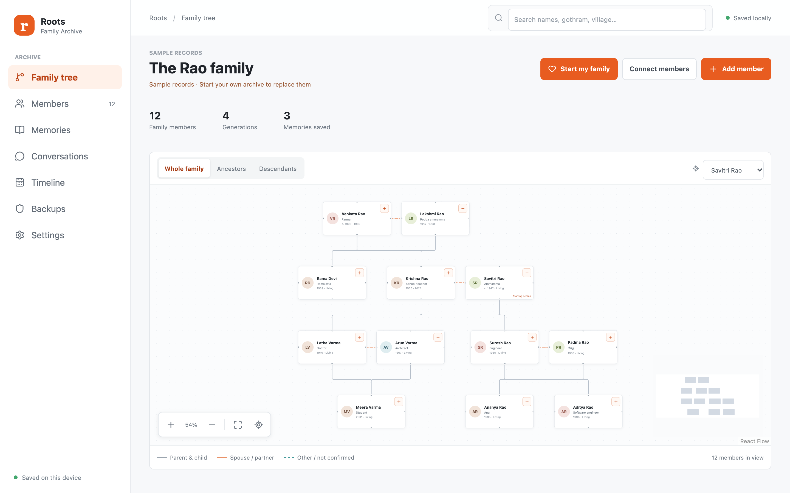
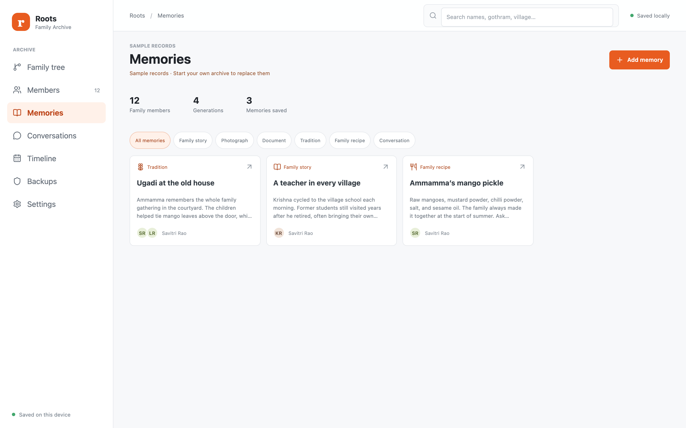
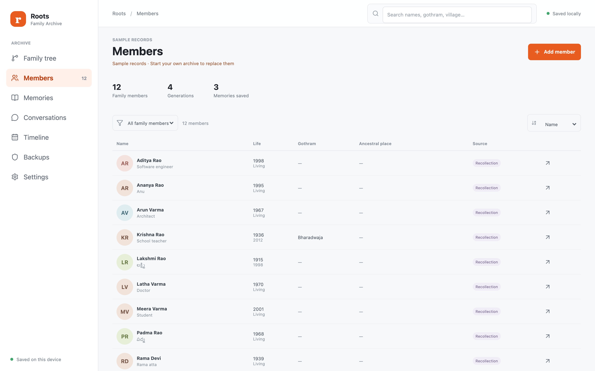
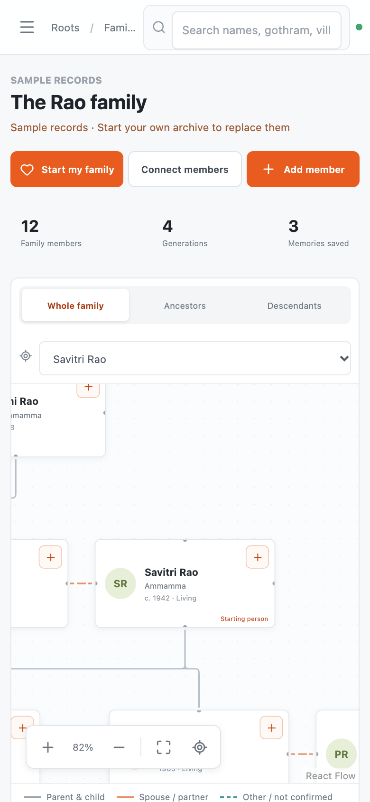

<div align="center">

# Roots · Family Archive

**A private, offline-first family tree and memory archive that lives entirely in your browser.**
No accounts, no servers, no tracking. Your family's records never leave your device.

[**Live demo**](https://siddhu-123.github.io/roots-family-archive/) · [Features](#features) · [Quick start](#quick-start) · [Backups](#backups)



</div>

> The demo opens with a **fictional sample family** (the Rao family, 12 members across 4 generations). Choose **Start my family** to replace it with your own archive. Everything you enter is stored in your own browser (IndexedDB).

## Features

- **Interactive family tree** built with React Flow and dagre: whole-family, ancestors and descendants views, minimap, zoom, keyboard navigation and reduced-motion support.
- **Made for Indian family structures**: name-only entry, native-script names (for example Telugu), gothram, maiden surname, ancestral village, nicknames and kinship terms, uncertain or approximate dates, and oral-history sources.
- **Memories**: stories, photos, documents, traditions, family recipes and voice recordings, each shareable across several members.
- **Guided conversations**: interview prompts with saved drafts to help capture an elder's stories.
- **Timeline and member profiles** with life events, places and family connections.
- **Local-only storage** (Dexie / IndexedDB): atomic saves, 30 automatic recovery snapshots, and protection against editing from a stale second tab.
- **Complete ZIP backup and restore** including every referenced photo, document and recording, validated before it replaces anything.
- **GEDCOM import and export** for moving genealogy records to and from other tools.
- **Installable PWA** that works offline, with a responsive layout down to 320 px and adjustable text size.

## Screenshots

| Memories | Members |
|---|---|
|  |  |

<p align="center"></p>

## Tech stack

React 19 · TypeScript · Vite · `@xyflow/react` + `@dagrejs/dagre` · Dexie · react-hook-form + Zod · Radix UI · `fflate` (ZIP) · `read-gedcom` · `vite-plugin-pwa` · Vitest · Playwright.

## Quick start

Requires Node.js 22.12 or later.

```bash
git clone https://github.com/Siddhu-123/roots-family-archive.git
cd roots-family-archive
npm ci
npm run dev
```

Open the address Vite prints (default `http://127.0.0.1:4173`). Use the same browser and address each time: a different hostname or port is a separate storage area.

### Scripts

| Command | What it does |
|---|---|
| `npm run dev` | Dev server on 127.0.0.1 |
| `npm run build` | Type-check and produce `dist/` (set `BASE_PATH=/sub/path/` to deploy under a sub-path) |
| `npm test` | Unit tests (Vitest, 36 tests) |
| `npm run test:ui` | Browser suite (Playwright; starts its own dev server on port 4183) |
| `npm run preview` | Serve the production build locally |
| `node scripts/capture-screenshots.mjs` | Regenerate the README screenshots from the sample data |

For production and offline checks, build, run `npm run preview -- --port 4184 --strictPort`, then in another terminal:

```bash
ROOTS_UI_BASE_URL=http://127.0.0.1:4184 ROOTS_UI_PRODUCTION=1 npm run test:ui
```

The browser suite uses local Chrome on macOS when available, otherwise Playwright Chromium (`npx playwright install chromium`). Microphone tests use a simulated input.

## Backups

Because data lives only in your browser, back it up:

- In **Backups**, choose **Export complete ZIP**. It contains all records and every photo, document and recording. Store a copy outside the browser.
- Restore from the same screen. Roots validates the ZIP (MIME allow-list, 50 MB per file, relationship checks), previews it, and saves a recovery snapshot before replacing anything.
- **GEDCOM** covers genealogy records only and does not include media. Use the ZIP to move or restore the whole archive.

## Project structure

```
src/
  App.tsx, main.tsx        app shell
  TreeView.tsx             React Flow tree and layout
  PeopleView.tsx, Profile.tsx, PersonEditor.tsx, Relationships.tsx
  Memories.tsx, Interview.tsx, Timeline.tsx
  BackupsView.tsx, backup.ts, gedcom.ts, interop.ts
  model.ts, storage.tsx    data model, dates, IndexedDB persistence
  seed.ts                  fictional Rao family sample
tests/                     Vitest unit tests and Playwright specs
scripts/                   screenshot capture
```

## Known limitations

- Data lives in one browser's storage. Clearing site data loses it unless you saved a ZIP backup.
- No sync, accounts or multi-device sharing.
- GEDCOM round-trips are lossy for parent/sibling link details (dates, places, status are exported only as notes).
- Tested in Chrome only; Safari, Firefox and real microphone hardware are untested.

## Third-party libraries

See [THIRD_PARTY.md](THIRD_PARTY.md).

## License

[MIT](LICENSE) © 2026 Satya Siddhartha Balanagu
